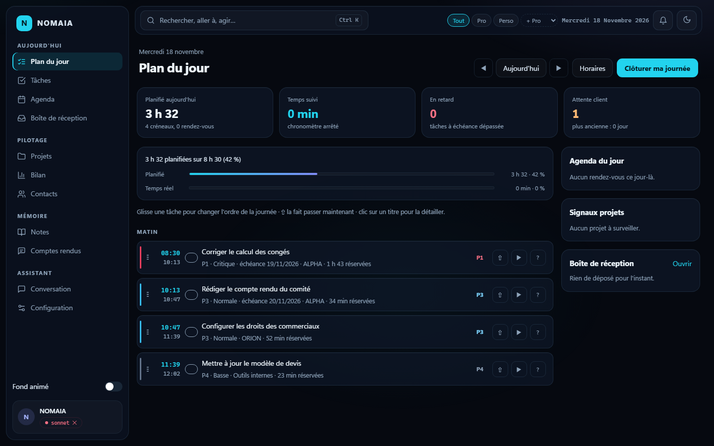

# NOMAIA

**NOyau d'organisation et Moteur d'Assistance Intelligent et Augmenté.**

Assistant personnel de tâches, auto-hébergé et piloté par un LLM. NOMAIA
reçoit ce que vous lui déposez (texte, capture d'écran, mail, message vocal
Telegram), en tire des tâches, construit votre plan du jour, suit le temps
passé, vous rappelle ce que les autres vous doivent et répond en langage
naturel. Il propose, vous décidez : rien n'est envoyé ni supprimé sans votre
validation.

Vos données restent dans votre base locale. Seul le contenu nécessaire à
chaque requête est transmis au fournisseur du LLM configuré.

```
Où en est le projet ALPHA ?
Décale le correctif paie à demain
Crée une tâche : rappeler le comptable, P2, 20 min
Qu'est-ce que je fais maintenant ?
```



## Fonctionnalités

- **Triage par LLM** : une capture, un mail ou un vocal devient des tâches
  (projet, priorité, durée, échéance), avec questions si c'est ambigu.
- **Plan du jour** : priorisation automatique selon échéances, priorités,
  rendez-vous et jours ouvrés ; durées calibrées sur le temps réellement passé.
- **Conversation** : chat web et Telegram, avec outils de lecture et
  d'écriture ; les modifications en chaîne passent par un plan à valider.
- **Projets, temps et bilan** : chronomètre, bilan hebdomadaire, rapport
  d'avancement, étapes de projet.
- **Interlocuteurs** : ce que vous devez à qui, ce qu'on vous doit, relances.
- **Agenda** : événements, répétitions, synchro ICS (Outlook) et Odoo en
  lecture seule, jours fériés par pays.
- **Sessions Claude Code** : un serveur MCP permet à Claude Code de créer et
  mettre à jour vos tâches pendant qu'il travaille.
- **Espaces pro et perso** séparés.

La documentation complète de chaque fonction est dans
[docs/GUIDE.md](docs/GUIDE.md).

## Prérequis

- Windows 10/11 (cible principale : icône de la barre des tâches, chiffrement
  des secrets par DPAPI, installeur).
- Python 3.10 ou plus récent.
- Un moteur de langage, au choix : clé API Anthropic, clé API Gemini, Ollama
  en local, ou Claude Code installé (`npm install -g @anthropic-ai/claude-code`).

Le serveur fonctionne aussi sous Linux et macOS en lançant `app.py`, sans
icône de barre des tâches ; les secrets y sont alors stockés **en clair** dans
la base (voir [SECURITY.md](SECURITY.md)).

## Installation

### Depuis les sources

```bash
git clone https://github.com/<compte>/nomaia.git
cd nomaia
python -m venv .venv
.venv\Scripts\activate          # Linux/macOS : source .venv/bin/activate
pip install -r requirements.txt
python tray.py                   # ou : python app.py (serveur seul)
```

L'interface s'ouvre sur <http://127.0.0.1:5555>. Le lien ouvert par l'icône
de la barre des tâches porte la clé d'accès, tirée au sort au premier
démarrage ; sans elle, l'interface refuse l'accès.

### Application Windows installée

```powershell
powershell -ExecutionPolicy Bypass -File tools\build.ps1 -Install
```

Produit un exécutable autonome (PyInstaller) dans
`%LOCALAPPDATA%\Programs\NOMAIA` ; les données vont dans `%APPDATA%\NOMAIA`
et ne sont jamais touchées par une mise à jour ou une désinstallation.

### Essayer avec des données fictives

```bash
NOMAIA_DATA_DIR=./demo-data python tools/seed_demo.py
NOMAIA_DATA_DIR=./demo-data python tray.py
```

## Configuration

Tout se règle dans l'interface, page **Configuration**. Les clés sont
chiffrées au repos (DPAPI sous Windows) et ne sont jamais renvoyées par l'API.
Les variables d'environnement facultatives sont listées dans
[.env.example](.env.example). Ce fichier sert de mémo : il n'est pas chargé
automatiquement, les variables se définissent dans le shell ou le raccourci de
lancement.

### Moteur de langage

**Configuration > Intelligence > Moteur d'intelligence** : choisir le
fournisseur (Claude Code, API Claude, API Gemini, Ollama), le modèle, saisir
la clé si besoin, puis **Tester la connexion**.

### Telegram

1. Créer un bot avec [@BotFather](https://t.me/BotFather) et copier son jeton.
2. **Configuration > Connexions > Téléphone (Telegram)** : coller le jeton.
3. Sur le téléphone, envoyer au bot `/pair <code>`, le code étant affiché sur
   la boîte de réception. Seul ce chat est ensuite accepté.

Le bot fonctionne en *long polling* : aucun port ouvert, rien d'exposé sur
Internet.

### Serveur MCP (Claude Code)

1. **Configuration > Connexions > Sessions Claude > Générer une clé.**
2. Lancer la commande affichée :

   ```bash
   claude mcp add --scope user nomaia -e NOMAIA_AGENT_KEY=<clé> -- python "<dossier>/integrations/claude_mcp.py"
   ```

3. Dans une nouvelle session Claude Code, `/mcp` doit lister `nomaia` ; les
   outils sont préfixés `nomaia_` (`nomaia_create_task`, `nomaia_log_work`…).

Le serveur MCP est un script Python sans dépendance : Python doit être
installé sur le poste, y compris avec l'application Windows installée.

## Sécurité

Le serveur n'écoute que sur `127.0.0.1`. Toutes les routes exigent une clé
d'accès tirée au sort (aucun mot de passe par défaut), sauf les fichiers
statiques, la saisie du code d'appairage du téléphone (qui vérifie le code
elle-même) et les routes du serveur MCP (clé dédiée). Les écritures venant
d'une autre origine sont refusées. Pour signaler une faille, voir
[SECURITY.md](SECURITY.md).

## Tests

```bash
python -m unittest discover -s tests -t .
```

Les tests utilisent `unittest` (bibliothèque standard) ; installer d'abord
`requirements.txt`. Chaque test part d'une base temporaire.

## Feuille de route

Prochaine évolution prévue : une image Docker (serveur seul). Le détail des
tâches est dans [docs/ROADMAP.md](docs/ROADMAP.md).

## Contribuer

Voir [CONTRIBUTING.md](CONTRIBUTING.md).

## Licence

[MIT](LICENSE)
